# Zuma

Red social completa inspirada en Facebook, hecha con **JavaScript puro** (sin frameworks, sin build), publicada en **GitHub Pages** y con **Supabase** como base de datos.

**En línea:** https://lucianomendozaoficial-dev.github.io/nimbook/

Los usuarios, las publicaciones, las historias, los chats y las ventas viven en la tabla `zuma_docs` de Supabase (un documento JSON por “archivo”), y las imágenes nuevas se guardan en **Supabase Storage**. Los **videos de historias y Reels** se guardan en **Cloudflare R2**. GitHub solo se usa para alojar el sitio estático.


| Modo oscuro | Móvil |
| --- | --- |
|  | 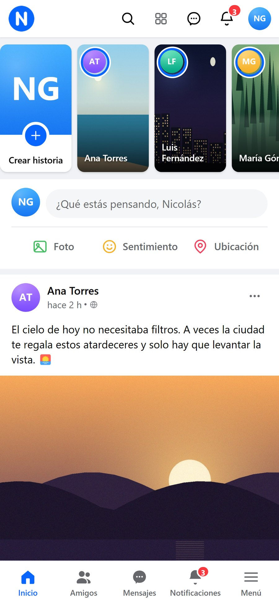 |

> Las capturas son de una instalación con datos de ejemplo (`tools/seed_demo.py`). La app se entrega **sin cuentas ni publicaciones**: la primera persona que entre se registra y publica.

---

## Novedades: iOS, historias, insignias y panel de control

| Muro «Para ti» | Venta de Shop en el muro | Contacto de la venta |
| --- | --- | --- |
| 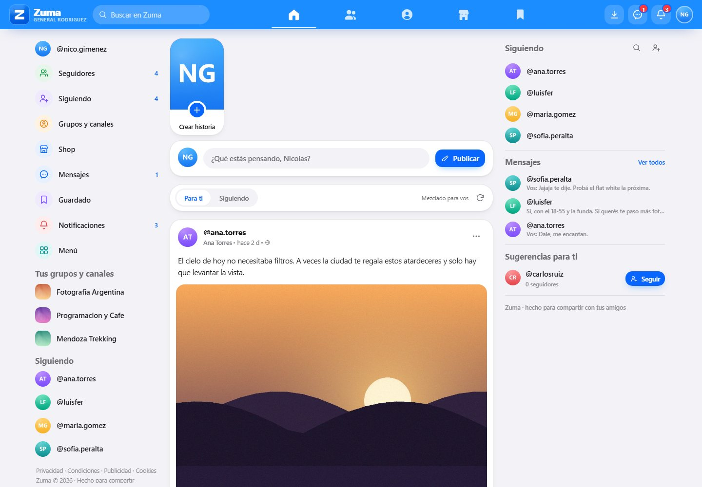 | 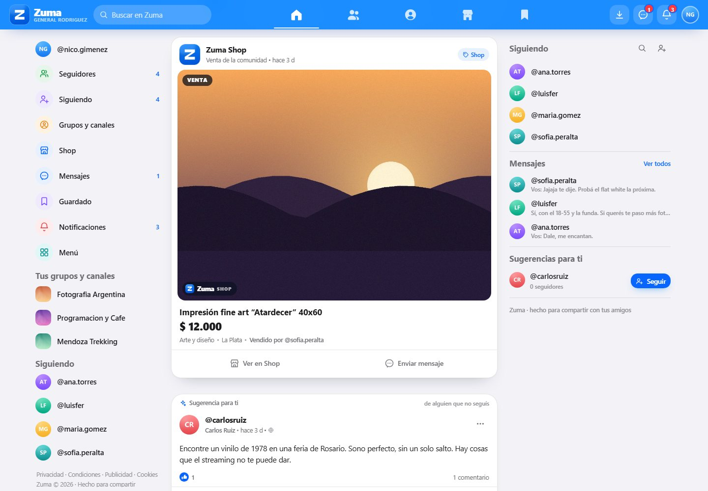 |  |

| Shop | Perfil con insignia | Publicar con más opciones |
| --- | --- | --- |
|  | 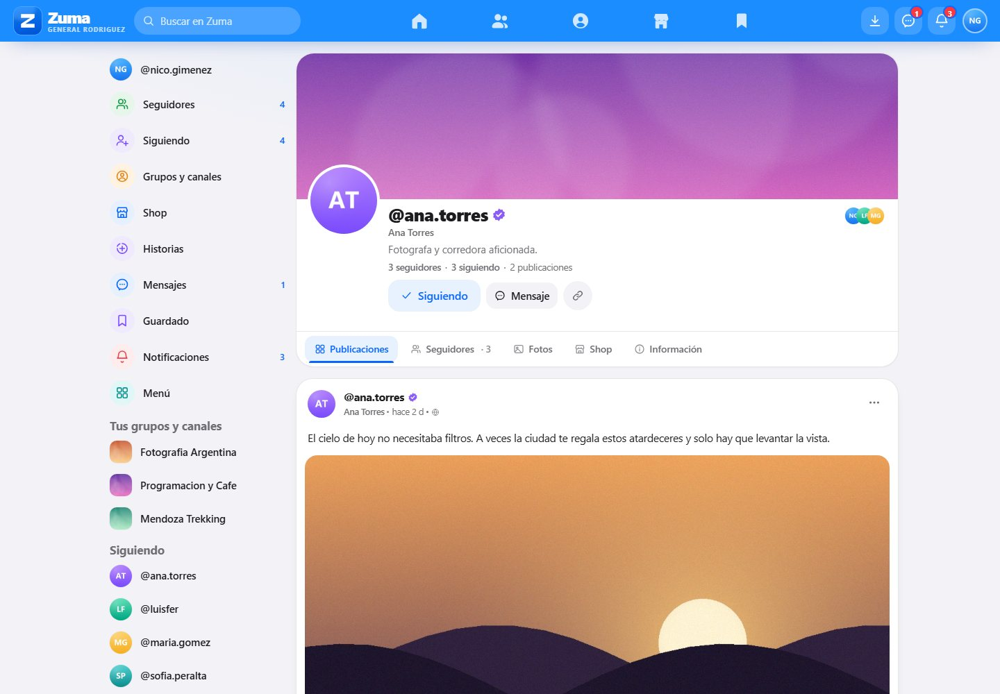 | 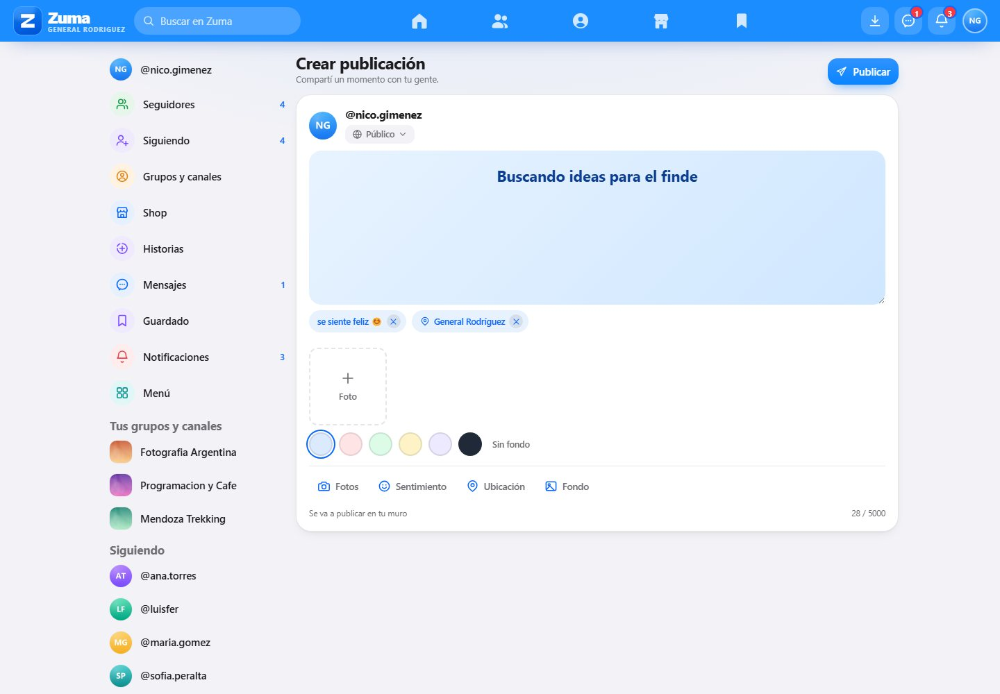 |

| Historias (sección aparte) | Cámara de historias | Vista previa y compartir |
| --- | --- | --- |
|  |  | 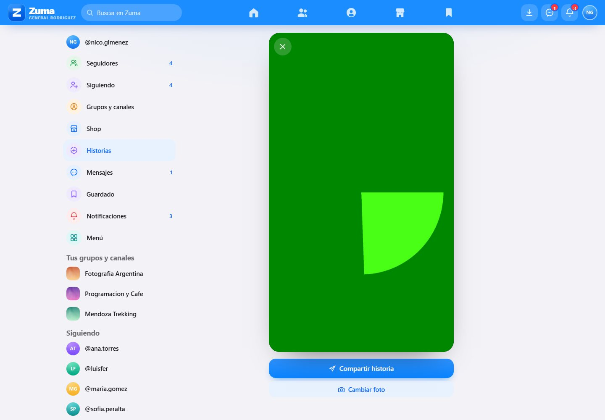 |

| Menú rediseñado | Eliminar cuenta | Insignias de verificación |
| --- | --- | --- |
|  | 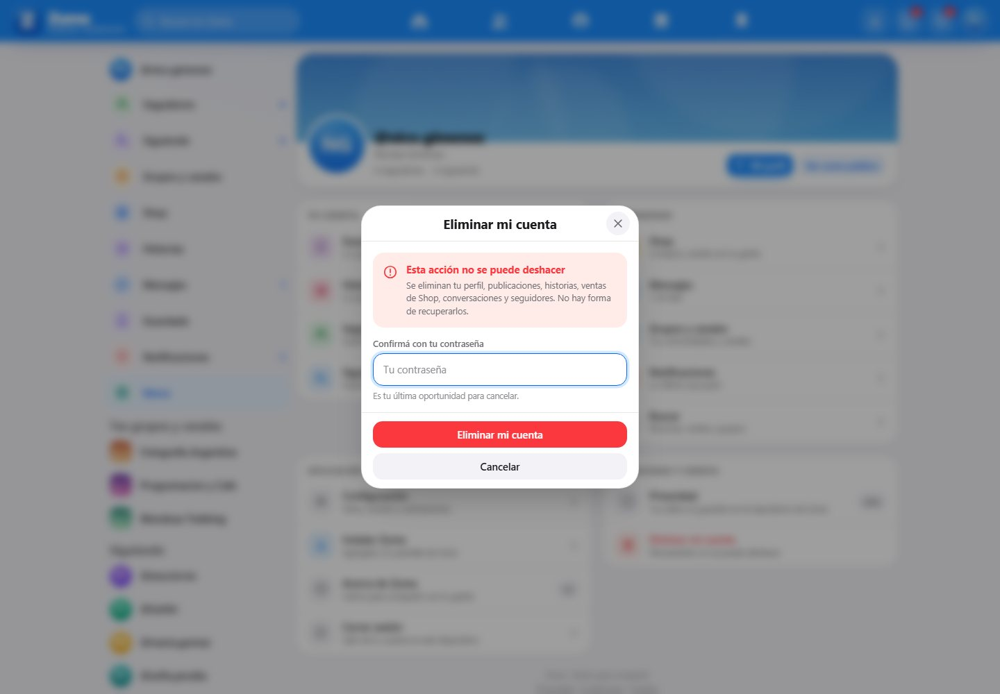 | 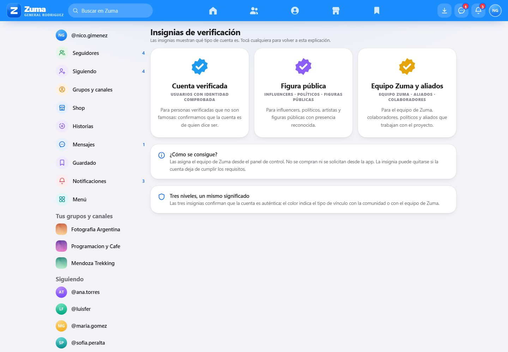 |

| Panel de control | Ficha en el panel | Búsqueda con pestañas |
| --- | --- | --- |
| 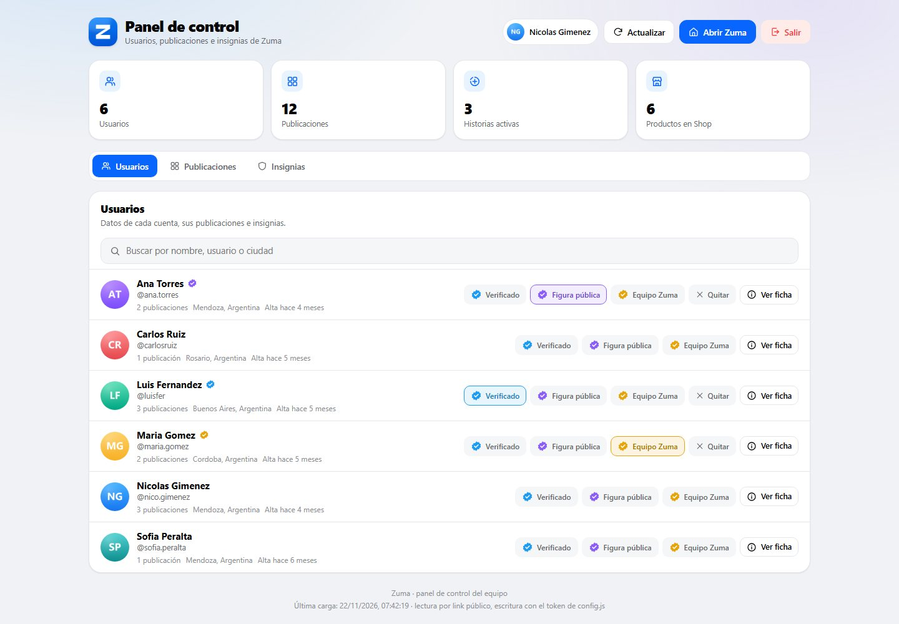 | 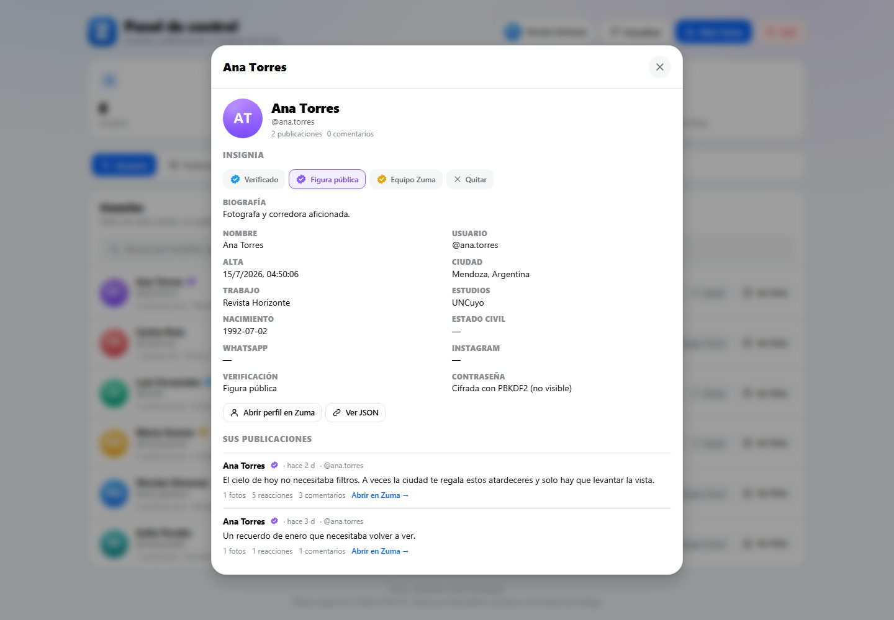 |  |

| Mensajes privados | Chat en el móvil | Zuma en el móvil |
| --- | --- | --- |
| 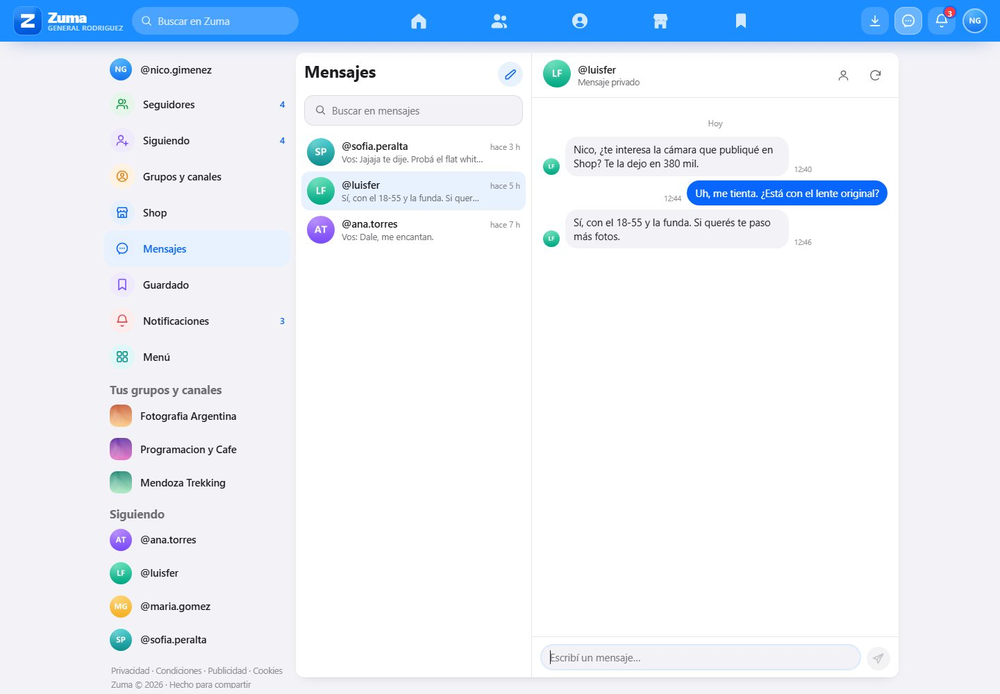 | 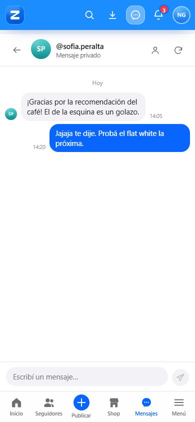 |  |

---

## Características

**Red social**
- Registro e inicio de sesión (contraseñas cifradas con PBKDF2-SHA256).
- Publicaciones con texto, hasta 10 fotos, **sentimiento, ubicación, privacidad y fondos de color** (como Facebook). Los enlaces del texto se detectan y se abren con un aviso y un botón **Abrir**; el fondo solo está disponible cuando la publicación es solo texto y el texto queda centrado.
- **Historias en su propia sección**: fotos 9:16 y **videos de hasta 60 s comprimidos a 720p**. Las imágenes duran 24 h y los videos **18 h**; al vencer se quitan y se borra el archivo de R2. La tuya va siempre primera, las no vistas antes que las vistas y dentro de cada persona se ven de la primera a la última; si ya viste la primera y hay una nueva, abre directo en la nueva.
- **Reels**: sección de videos verticales de hasta **2 minutos**, comprimidos a 720p, con scroll tipo TikTok, **solo me gusta** (sin comentarios) y subida desde la app.
- **Galería propia**: las fotos importadas del dispositivo quedan guardadas y comprimidas en el navegador (IndexedDB), así después las elegís desde la galería de Zuma sin abrir el selector del sistema cada vez.
- **Insignia única azul**: la cuenta verificada cuesta **$10.000/mes**. Incluye mayor visibilidad en el muro, perfil en sugerencias, tipo de cuenta (influencer, gamer, político/a, artista, deportista, periodista o marca) y un estilo especial en el perfil público.
- **Solicitud de insignia**: se piden nombre completo, DNI, localidad, fecha de nacimiento y tipo de cuenta. Los datos se envían automáticamente al chat privado de **@soporte** y quedan en el panel.
- **Perfil verificado**: las cuentas con insignia azul tienen un perfil público normal, con ilustraciones y detalles azules, la franja **Cuenta verificada** (sin fecha) y el tipo de cuenta.
- **Muro más inteligente**: combina afinidad, reacciones, comentarios, recencia y un impulso especial para cuentas verificadas, que mantienen alcance aunque hayan publicado hace tiempo.
- **Promociones de Shop**: las ventas que aparecen en el muro tienen una tarjeta destacada con la etiqueta **Promoción de Shop**, vendedor, precio y botones para ver o consultar.
- **Soporte**: perfil oficial **@soporte**, chat privado con los usuarios, avisos publicados desde el panel y **reportes de cuentas con motivo**. Todo aparece en la pestaña **Soporte** del panel.
- **Panel de control** (`panel.html`): pide una **contraseña de verificación** al entrar y permite ver usuarios, publicaciones, datos, insignias con vencimiento, solicitudes de verificación, reportes, chat de soporte y configurar los datos de pago.
- **Actualizar Zuma** en el menú: borra la caché, desregistra el service worker y recarga para ver los cambios sin Ctrl+R.
- **Descargar imágenes** de publicaciones e historias desde el menú de la publicación o el visor.
- **Eliminar cuenta** desde el menú: pide la contraseña, avisa que es permanente y borra perfil, publicaciones, historias, ventas, conversaciones y vínculos.
- Muro con orden tipo Facebook: lo tuyo, lo de las personas que seguís y lo de tus grupos tiene prioridad, pero **no queda en orden cronológico**; se mezcla en bloques con publicaciones de gente que no seguís (marcadas como «Sugerencia para ti») y se evita que aparezcan dos publicaciones seguidas de la misma persona. Pestañas **Para ti** y **Siguiendo**, y al cargar más se agrega al final sin desordenar lo que ya estabas viendo.
- **Shop**: mercado con productos de la gente de Zuma, búsqueda y categorías, publicación con fotos, precio, estado y ubicación, ficha con vendedor, botón para escribirle, marcar como vendido y eliminar lo propio. El botón **Vender algo** queda flotante.
- **Contacto de la venta**: al publicar se puede activar el contacto y elegir **WhatsApp** o **Instagram** (con sus logos). En la ficha aparecen esos botones y, para quien no quiera usarlos, el chat privado de Zuma.
- **Ventas en el muro**: cada tanto aparece una venta de Shop mezclada en «Para ti», sin importar a quién sigas, con la **marca de agua de Zuma** y la etiqueta «Venta» para que se note que es de Shop.
- **Mensajes privados estilo WhatsApp** (solo el estilo): bandeja con contador de no leídos, burbujas verdes/blancas, separadores de fecha, hora dentro del mensaje y chat uno a uno. **Tiempo real** con Supabase Realtime: el mensaje aparece al instante, sin esperar 5 segundos. Los sonidos avisan cuando llega un mensaje y no tenés ese chat abierto.
- **Escribiendo…** en el chat y **respuesta citada**: si abrís el chat desde una venta de Shop, la publicación queda citada arriba del mensaje, como en WhatsApp.
- **Emojis** en el chat, los comentarios y al crear publicaciones, con selector por categorías y recientes.
- **Grupos y canales personalizables**: portada, color, emoji, descripción, categoría, reglas, privacidad y edición para el dueño. El canal usa el mismo editor.
- **Todo en tiempo real**: publicaciones, reacciones, comentarios, grupos, historias, Shop, notificaciones, soporte y mensajes se actualizan solos entre dispositivos con Supabase Realtime; si el canal se cae, queda un sondeo de respaldo.
- Reacciones con un toque (me gusta) o manteniendo apretado (6 opciones), comentarios y respuestas, compartir y guardar.
- Reacciones: 👍 Me gusta, ❤️ Me encanta, 😂 Me divierte, 😮 Me asombra, 😢 Me entristece, 😡 Me enfada.
- Comentarios, respuestas anidadas, reacciones y fotos en comentarios.
- Compartir publicaciones (con la original incrustada).
- La insignia azul es la única: incluye identidad confirmada, alcance, sugerencias, tipo de cuenta y perfil destacado. Se renueva por mes.
- El **nav principal ya no muestra Seguidores**; se llega a seguidores/siguiendo desde el perfil.
- Seguidores: seguir y dejar de seguir, sugerencias con seguidores en común, sin solicitudes.
- Grupos públicos y privados con publicaciones, miembros y administración.
- Canales: solo el creador publica; el resto los sigue y lee.
- Estado civil y datos personales editables desde «Mi perfil».
- Notificaciones con campana y contador.
- Perfiles con portada, foto, biografía y pestañas (publicaciones, seguidores, fotos, **Shop** e información); botón para compartir el perfil.
- **Buscador con pestañas** (Todo, Personas, Shop, Grupos), ranking inteligente, coincidencias resaltadas, etiquetas para explorar, sugerencias y búsquedas recientes.
- **Contactar a Luciano** desde el menú: WhatsApp **+54 11 5118-6792** e Instagram **@lucianomdz.ok**.
- **Menú rediseñado** con el perfil, las secciones de la app, **Actualizar Zuma**, **Contactar**, **Panel de control**, **Insignia de verificación** y la zona de privacidad y cuenta.
- Modo claro / oscuro / automático, toasts, menús, visor de imágenes.

**Diseño**
- Estilo **iOS** renovado: barra superior y navegación inferior translúcidas con desenfoque, tarjetas redondeadas, hojas modales, botones con presión y tipografía del sistema. El nombre **Zuma** aparece junto al logo también en el móvil.
- Sin flechas de retroceso en las secciones: se vuelve con el botón del dispositivo (o con la navegación inferior en el móvil).
- Réplica del layout de Facebook: barra superior, columna izquierda, feed central y contactos a la derecha.
- Responsive: 3 columnas en escritorio, rail de iconos en tablet, feed completo y navegación inferior en móvil.
- Logo propio en PNG para todas las resoluciones, favicon `.ico`, iconos PWA y `manifest` instalable.

**Supabase**
- El sitio es 100 % estático (GitHub Pages). La base de datos es **Postgres en Supabase**: una tabla `zuma_docs` con `path`, `data jsonb` y `updated_at`, más el bucket público `zuma-media` para las imágenes nuevas.
- **Lecturas y escrituras** desde el navegador con `@supabase/supabase-js` (incluido en `js/vendor/`). No hay token de GitHub en la app.
- Las escrituras se agrupan en cola y usan **bloqueo optimista** con `updated_at`: si otra persona escribió el mismo documento, se relee y se reintenta para no perder cambios.
- Todo lo descargado se guarda en el navegador (localStorage) para no pedirlo dos veces; los cambios llegan por **Supabase Realtime** y el chat abierto tiene un sondeo de respaldo cada 5 s.
- Las imágenes viejas siguen en GitHub Pages; las nuevas se suben a Supabase Storage y se guardan como URL pública.

---
 
## Panel de control

`panel.html` es una página aparte para el equipo. Pide una **contraseña de verificación** al entrar (se guarda solo en la pestaña) y permite ver usuarios, datos, publicaciones, editar sus datos y contraseña, asignar la insignia con vencimiento y gestionar soporte. Lee y escribe en Supabase con la clave publicable de `config.js`.

- Pestañas: **Usuarios** (buscar, ver ficha, editar datos y contraseña, asignar insignia), **Publicaciones**, **Insignias** (la única insignia azul, usuarios con vencimiento y avisos), **Soporte** (solicitudes, reportes, chat y avisos) y **Configuración** (datos de pago).
- La insignia se guarda en `usuarios/<id>.json` (`verification: { type: "celeste", at, until, category, reminders }`) y en `usuarios/index.json` (`verification: "celeste"`).
- En **Soporte** se aprueban o rechazan solicitudes, se elige la fecha de vencimiento, se resuelven reportes y se responde el chat como @soporte. El perfil de soporte se crea solo la primera vez que se abre el panel.
- En **Configuración** se cargan alias, CVU/CBU, titular, banco e instrucciones de pago. Se incluyen en el mensaje privado que @soporte envía **7 días y 2 días antes** del vencimiento.

> El panel tiene una contraseña de verificación, pero se comprueba en el navegador y el código es público. No reemplaza a Supabase Auth: para una comunidad grande hay que cerrar el panel con autenticación real y políticas por usuario. No compartas el enlace ni la contraseña.

---

## Estructura de los documentos (Supabase)

Todo vive en la tabla `zuma_docs`: una fila por documento, con `path` como clave, `data` en JSONB y `updated_at`. Los `path` mantienen los nombres de antes, así el código y las acciones siguen igual:

Un documento por cosa: así dos personas no pisan el mismo registro y las escrituras son pequeñas.

```
data/
  usuarios/index.json          lista liviana: id, usuario, nombre, foto, alta e insignia
  usuarios/<id>.json           ficha completa (contraseña cifrada, bio, contacto, insignia…)
  feed/index.json              últimos 200: id, autor y fecha (nada más)
  feed/<post>.json             publicación completa (texto, fotos, contadores)
  likes/<usuario>.json         { postId: tipo de reacción } de cada persona
  comentarios/<post>/index.json    lista de comentarios del post
  comentarios/<post>/<id>.json     comentario completo
  siguiendo/<usuario>.json     a quién sigue
  seguidores/<usuario>.json    quién lo sigue
  notificaciones/<usuario>.json    bandeja de cada persona
  grupos.json                  grupos y canales (tipo, dueño y miembros)
  historias.json               historias activas (fotos 24 h y videos 18 h; los videos apuntan a R2)
  reels/index.json             metadatos de Reels: video R2, poster, autor, duración y likes
  soporte/verificaciones.json  solicitudes de la insignia azul (nombre, DNI, localidad, nacimiento y tipo)
  soporte/reportes.json        cuentas reportadas y motivo
  soporte/config.json          datos de pago que se envían en los avisos
  tienda/index.json            productos de Shop: id, vendedor, foto, precio y estado
  tienda/<producto>.json       ficha completa (descripción, fotos y contacto opcional)
  mensajes/bandejas/<usuario>.json   conversaciones de cada persona y no leídos
  mensajes/hilos/<a>__<b>.json  mensajes del chat entre dos personas
media/
  perfiles/  portadas/  publicaciones/  historias/  grupos/  tienda/
```

**Shop y mensajes funcionan con la misma idea:** cada documento se lee y se escribe en Supabase. Un mensaje nuevo se guarda en el hilo compartido `mensajes/hilos/<id-menor>__<id-mayor>.json` y en las dos bandejas: la mía queda sin pendientes y la de la otra persona suma un no leído. El cambio se emite por Supabase Realtime y el chat abierto se actualiza al instante; el sondeo de 5 segundos queda como respaldo.

**Regla de oro:** una publicación nunca guarda sus comentarios ni sus reacciones adentro.
El «me gusta» escribe primero en `likes/<usuario>.json` y después, si se puede, suma el contador del post.

```json
{
  "id": "p_m3f8",
  "authorId": "u_ab12",
  "text": "Atardecer desde el balcón",
  "media": [{ "path": "media/publicaciones/m3f8k2a1.jpg", "type": "image/jpeg" }],
  "privacy": "public",
  "reactions": { "love": 4, "like": 9 },
  "commentsCount": 3,
  "createdAt": "2026-11-19T22:10:00Z"
}
```

## Puesta en marcha

### 1. Crea la tabla y el bucket en Supabase

1. Abre el **SQL Editor** del proyecto: https://supabase.com/dashboard/project/jnewregdsxppdzfdvsqb/sql/new
2. Copia y ejecuta todo **`supabase/schema.sql`**.
3. Al terminar deben existir la tabla `public.zuma_docs` y el bucket público `zuma-media`.

Ese archivo también crea las políticas RLS y los permisos para la clave publicable.

> No hace falta `npm install` ni un paso de build: el cliente de Supabase para el navegador ya está en `js/vendor/supabase.js`.

### 2. Configura la conexión

`config.js` ya tiene la URL del proyecto, la clave publicable y el bucket:

```js
window.NIMBOOK_CONFIG = {
  supabaseUrl: 'https://jnewregdsxppdzfdvsqb.supabase.co',
  supabaseKey: 'sb_publishable_…',
  storageBucket: 'zuma-media',
};
```

> La clave publicable está pensada para el navegador. La seguridad real la dan las políticas de Supabase, no el secreto de la clave. Nunca pongas la `service_role` en `config.js` ni en el sitio.

### 3. Publica la aplicación

Con Node.js instalado:

```bash
node tools/deploy.mjs --repo tuusuario/nimbook --token github_pat_xxx --pages
```

Ese token es **solo para que el script suba el sitio a GitHub Pages**; no se guarda en la app ni en `config.js`.

### 4. Ábrela y regístrate

La base arranca **vacía**: no se migran datos viejos. Cada persona vuelve a crear su cuenta y publica de nuevo.

1. Entra en `https://tuusuario.github.io/nimbook/`.
2. Pulsa **Crear una cuenta nueva**, completa tus datos y publica tu primer momento.
3. Para asignar insignias, entra a `panel.html` e ingresá la contraseña de verificación. Desde **Configuración** cargá los datos de pago antes de aprobar.

> El repositorio puede ser público: GitHub Pages lo necesita para servir el sitio. Los datos no están en el repositorio; están en Supabase.

---

## Dominio propio

Sí. GitHub Pages permite usar un dominio comprado en otra parte (Namecheap, Hostinger, Cloudflare, etc.) sin cambiar el código de Zuma, porque las rutas de la app son relativas.

1. Comprá el dominio y entrá al panel DNS del registrador.
2. Elegí un nombre canónico:
   - **Con `www`:** creá un registro **CNAME** para `www` apuntando a `lucianomendozaoficial-dev.github.io`.
   - **Con el dominio raíz:** creá cuatro registros **A** para `@`:
     - `185.199.108.153`
     - `185.199.109.153`
     - `185.199.110.153`
     - `185.199.111.153`
   - Opcionalmente, agregá los **AAAA** de GitHub Pages si tu proveedor los soporta.
3. Si usás Cloudflare como DNS, dejá los registros en **DNS only** (nube gris) durante la configuración; el proxy naranja puede interferir con el certificado de GitHub Pages.
4. En GitHub: **Repositorio → Settings → Pages → Custom domain**, escribí el dominio (`www.tudominio.com` o `tudominio.com`) y guardá.
5. Esperá la verificación DNS y activá **Enforce HTTPS**. GitHub emite el certificado automáticamente.
6. GitHub crea un archivo `CNAME` en la rama publicada; no lo borres. Si preferís, agregalo también al proyecto con el dominio.

Con el dominio propio, la app queda en `https://tudominio.com/` (sin `/nimbook/`), el panel en `/panel.html` y el reset en `/reset.html`. Supabase y R2 no necesitan cambios: R2 ya permite CORS para cualquier origen y Supabase no restringe el origen de la clave publicable.

> El dominio anterior de GitHub Pages sigue funcionando salvo que lo desactives. La PWA instalada desde el dominio viejo es otra instalación; desde el dominio nuevo se instala de cero.

## Base vacía

La primera vez que abras la app con Supabase, la tabla `zuma_docs` está vacía y vas a ver la pantalla de registro. No hay datos de ejemplo en producción y no se importa nada de GitHub: las cuentas y publicaciones se crean de nuevo.

Para empezar de cero otra vez, ejecutá en el SQL Editor:

```sql
delete from public.zuma_docs;
```

## Probarlo en tu PC

Haz doble clic en **`Zuma.bat`**. Abre el navegador en `http://localhost:4173/` con un servidor local y **datos de prueba guardados en tu PC**: los cambios que hagas ahí no los ve nadie hasta que publiques.

- Los archivos `js` y `css` se **recargan solos** al guardarlos (no hace falta refrescar).
- El servidor local **emula Supabase** (`/sb/rest/v1` y `/sb/storage/v1`) y guarda los documentos en `data/` y las imágenes nuevas en `media/`.
- Los usuarios y publicaciones de prueba viven en `data/` y `media/` de tu carpeta.
- Necesita Node.js (https://nodejs.org). Si no está instalado, el acceso directo te lo indica.

**Datos de ejemplo con 6 personas, fotos, grupos y canales**

```bash
python tools/seed_demo.py
node tools/mock-server.mjs --port 4173 --open   # luego entra con ?demo=1
```

Las cuentas de ejemplo usan la contraseña `demo1234`.

**Volver a empezar sin datos**

```bash
node tools/reset.mjs --wipe-media   # JSON vacíos y carpetas de imágenes limpias
```

**Pruebas automáticas** (Edge headless): `node tools/flow.mjs` publica, reacciona, comenta, sigue y edita el perfil contra el servidor local.

> Abrir `index.html` con doble clic **no funciona**: los navegadores bloquean el JavaScript en `file://`. Si lo haces, verás un aviso explicándolo.

---

## Detalles técnicos

| Tema | Decisión |
| --- | --- |
| Framework | Ninguno: módulos ES nativos, DOM a mano |
| Rutas | Hash (`#/u/usuario`, `#/p/id`, `#/tienda`, `#/tienda/producto`, `#/mensajes`, `#/mensajes/usuario`, `#/historias`, `#/historias/crear`, `#/verificacion`, `#/reels`) y `panel.html`, compatibles con Pages |
| Estado | Store propio con índices (`Map`) y selectores |
| Base de datos | Supabase Postgres, tabla `zuma_docs` (`path` + `data jsonb` + `updated_at`) |
| Concurrencia | Cola por documento + bloqueo optimista con `updated_at` y reintentos |
| Caché | Memoria + `localStorage` por documento (30 s en memoria) |
| Cuota | La del plan de Supabase; ya no se gasta la API de GitHub para datos |
| Tiempo real | Supabase Realtime Broadcast: cada escritura avisa a los demás dispositivos, más indicador de “escribiendo…”; el chat tiene sondeo de respaldo cada 5 s |
| Chat en vivo | Realtime instantáneo + sonido si el chat no está abierto; el sondeo queda como respaldo |
| Contraseñas | PBKDF2-SHA256, 150 000 iteraciones, sal de 16 bytes |
| Historias | Fotos 24 h y videos de 60 s máx. / 18 h, 720p; galería propia en IndexedDB; videos en R2 |
| Reels | Videos verticales de 2 min máx., 720p, solo like; metadatos en Supabase y archivos en R2 |
| Enlaces | Los links del texto se abren desde un modal con un único botón **Abrir** |
| Verificación | Una sola insignia azul, **$10.000/mes**. Guarda nombre completo, DNI, localidad, nacimiento y tipo de cuenta en `soporte/verificaciones.json`; vence en la fecha que fija el panel |
| Soporte | Perfil @soporte, chat privado, reportes de cuentas, avisos publicados desde el panel y recordatorios de vencimiento |
| Pagos | Datos configurables en `soporte/config.json`; se incluyen en los avisos 7 y 2 días antes del vencimiento |
| Feed | Ranking con afinidad, engagement, recencia, impulso y piso de alcance para cuentas verificadas; promociones de Shop destacadas |
| Panel | `panel.html` + `js/panel.js`, contraseña de verificación en el navegador; lectura y escritura en Supabase |
| Eliminar cuenta | Verifica la contraseña y borra perfil, posts, historias, ventas, conversaciones y vínculos; el aviso indica que no se puede deshacer |
| Imágenes | `canvas` → JPEG, máx. 1600 px y ~1,4 MB; las nuevas van a Supabase Storage |
| Vídeos | **No soportados** (por diseño); solo imágenes |

### Límites conocidos

- Las políticas RLS actuales permiten leer y escribir con la clave publicable. Es una etapa de transición: para una comunidad abierta conviene migrar el login a **Supabase Auth** y cerrar las políticas por usuario.
- La `service_role` de Supabase **nunca** va en el navegador ni en `config.js`: solo se usa desde el SQL Editor o scripts privados.
- Los mensajes privados se guardan como JSON en Supabase: la app solo los muestra dentro del hilo de las dos personas, pero **no están cifrados**. Alguien con la clave publicable y las políticas actuales podría leer la tabla. Para conversaciones realmente secretas haría falta cifrado de extremo a extremo, que esta versión no incluye.
- La cámara de historias necesita HTTPS (GitHub Pages lo es) y permiso del navegador; si no está disponible, la app ofrece elegir una foto de la galería.
- Los videos se comprimen en el navegador a **720 × 1280** con `MediaRecorder`; la compresión tarda lo que dura el video. Los archivos viven en R2 y los metadatos en Supabase.
- **Seguridad de R2:** al ser una app estática, la URL firmada se genera en el navegador y las credenciales de R2 están en `config.js`. Cualquiera que abra el código puede verlas y subir/borrar archivos del bucket. Para producción hay que mover la firma a un Worker o Edge Function y rotar las claves. No uses ese bucket para archivos privados.
- Los videos de historias se eliminan de la app a las 18 h y se intenta borrar el archivo de R2; si nadie abre la app, la limpieza queda pendiente.
- El trámite de verificación guarda nombre completo, DNI, localidad y fecha de nacimiento en Supabase. El panel pide una contraseña de verificación, pero se comprueba en el navegador; no es autenticación real. Para producción conviene cerrar el panel con Supabase Auth.
- La insignia azul es la única; los datos viejos con otros colores se muestran como azul.
- Los avisos de vencimiento se envían al abrir el panel o la app del usuario (7 y 2 días antes), no con un cron del servidor: al ser un sitio estático no hay proceso en segundo plano.
- La galería propia solo contiene las fotos que el usuario importó desde el dispositivo; el navegador no permite leer toda la galería del teléfono sin permiso.
- Al eliminar una cuenta se borran sus documentos JSON, pero las imágenes ya subidas a Storage y los comentarios sueltos que haya dejado en otras publicaciones pueden quedar.
- La contraseña del panel viaja y se comprueba en el cliente: alguien con experiencia puede saltearla leyendo el código. No la uses como única protección de datos sensibles.
- Si dos personas escriben a la vez, la app relee y reintenta; en el peor caso avisa para volver a intentarlo.

---

## Archivos del proyecto

```
index.html              punto de entrada (SPA)
config.js               conexión con Supabase y Cloudflare R2
supabase/schema.sql     tabla zuma_docs + bucket zuma-media + políticas RLS
manifest.webmanifest    PWA instalable
Zuma.bat           lanzador local para Windows (modo prueba, sin publicar)
Iniciar-Zuma.ps1     servidor local sin dependencias
css/base.css            tokens, reset, tipografía, utilidades
css/app.css             barra superior, columnas, navegación, componentes
css/pages.css           feed, perfil, mensajes, seguidores, grupos, ajustes
js/app.js               arranque, shell y rutas
js/vendor/supabase.js   cliente de Supabase para el navegador (sin build)
js/core/net.js          Supabase: documentos, Storage, cola y bloqueo optimista
js/core/store.js        estado, índices y selectores
js/core/actions.js      todas las escrituras (posts, seguidores, chats…)
js/core/auth.js         registro, acceso y sesión
js/core/crypto.js       PBKDF2
js/core/media.js        compresión y subida de imágenes
js/core/video.js        compresión de videos a 720 × 1280 y poster
js/core/r2.js           Cloudflare R2: URLs firmadas, subida y borrado
js/core/ui.js           modales, menús, toasts, visor de imágenes
js/pages/reels.js       sección Reels vertical con like
js/pages/verification.js         explicación y solicitud de la insignia azul
js/core/router.js       rutas por hash
js/components/*         topbar, sidebars, compositor, tarjeta de post, historias, insignias, emojis
js/components/emoji-picker.js   selector de emojis por categorías y recientes
js/core/verification.js   insignia única, categorías, vencimiento y avisos
js/core/reminders.js      mensajes privados de @soporte 7 y 2 días antes
js/core/realtime.js     Supabase Realtime: cambios en vivo entre dispositivos
js/core/gallery.js      galería propia con IndexedDB (fotos importadas)
js/core/native.js       transiciones de vista y vibración nativa
js/pages/group-editor.js        crear y personalizar grupos/canales
css/features.css        mensajes estilo WhatsApp, emojis, grupos y márgenes móviles
js/pages/*              feed, Shop, grupos, historias con cámara, mensajes, perfil, búsqueda, verificación, Reels, menú…
js/core/story-fonts.js  fuentes para las historias viejas que ya tenían texto
js/core/update.js       Actualizar Zuma: limpia caché, desregistra el SW y recarga
css/ios.css             capa de estilo iOS y estilos de las secciones nuevas
panel.html              panel de control del equipo
js/panel.js             usuarios, publicaciones e insignias (Supabase)
css/panel.css           estilos del panel
js/components/verified-badge.js  insignia azul única
js/pages/verification.js         explicación y solicitud de la insignia azul
assets/logo/            logo PNG en todos los tamaños + favicon
tools/                  despliegue, emulador local de Supabase, datos de ejemplo y pruebas
```

Hecho para que tengas tu propia red social sin depender de nadie. 🚀
