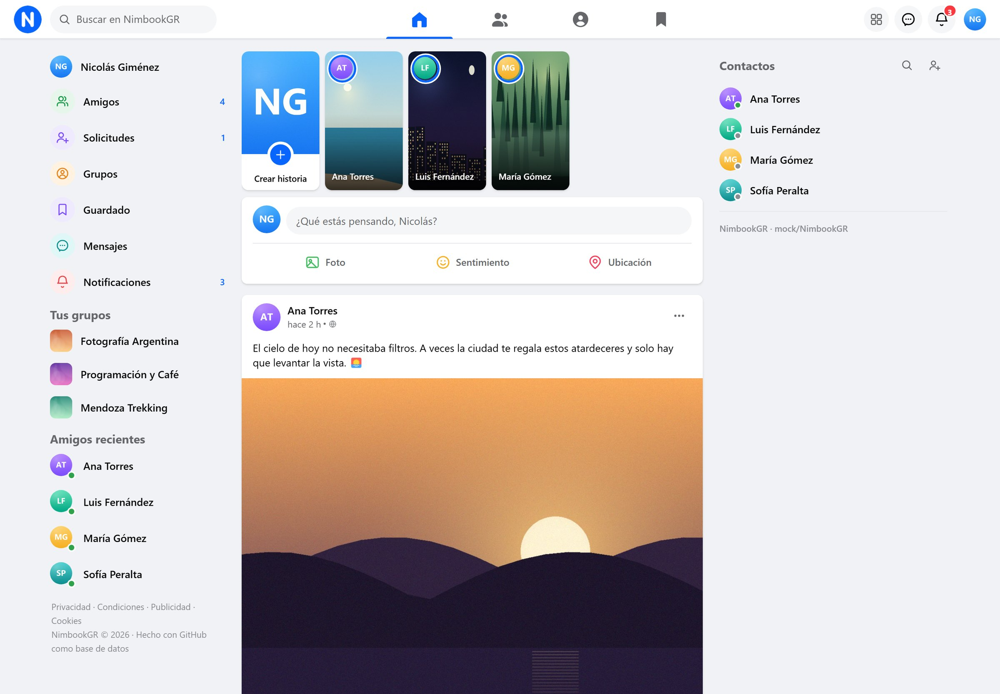
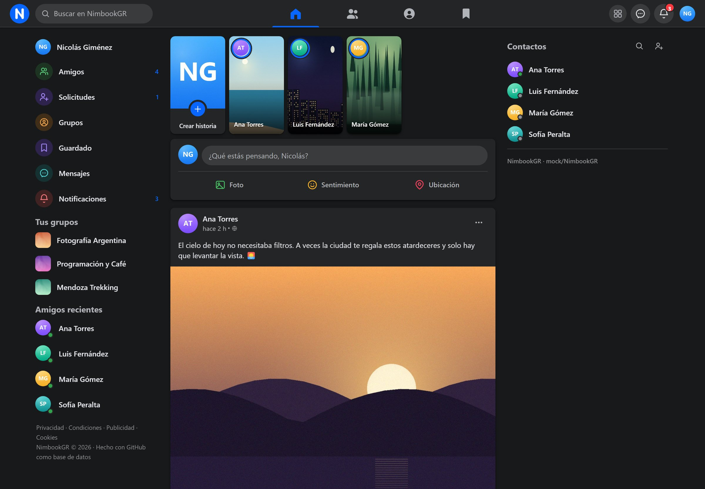

# Zuma

Red social completa inspirada en Facebook, hecha con **JavaScript puro** (sin frameworks, sin build) y con **tu repositorio de GitHub como base de datos**.

**En línea:** https://lucianomendozaoficial-dev.github.io/nimbook/

Los usuarios, las publicaciones, las historias, los chats y las imágenes viven en archivos JSON y carpetas dentro del repositorio. La aplicación los lee y los escribe directamente con la API de GitHub desde el navegador, así que se puede publicar gratis en GitHub Pages.



| Modo oscuro | Móvil |
| --- | --- |
|  |  |

> Las capturas son de una instalación con datos de ejemplo (`tools/seed_demo.py`). La app se entrega **sin cuentas ni publicaciones**: la primera persona que entre se registra y publica.

---

## Características

**Red social**
- Registro e inicio de sesión (contraseñas cifradas con PBKDF2-SHA256).
- Publicaciones con texto, hasta 10 fotos, sentimiento, ubicación y privacidad (público / seguidores / solo yo).
- Reacciones con un toque (me gusta) o manteniendo apretado (6 opciones), comentarios y respuestas, compartir y guardar.
- Reacciones: 👍 Me gusta, ❤️ Me encanta, 😂 Me divierte, 😮 Me asombra, 😢 Me entristece, 😡 Me enfada.
- Comentarios, respuestas anidadas, reacciones y fotos en comentarios.
- Compartir publicaciones (con la original incrustada).
- Historias de 24 h con visor automático.
- Seguidores: seguir y dejar de seguir, sugerencias con seguidores en común, sin solicitudes.
- Grupos públicos y privados con publicaciones, miembros y administración.
- Canales: solo el creador publica; el resto los sigue y lee.
- Estado civil y datos personales editables desde «Mi perfil».
- Notificaciones con campana y contador.
- Perfiles con portada, foto, biografía y pestañas (publicaciones, seguidores, fotos, información).
- Guardados, buscador de personas (por nombre, apellido o usuario) y configuración.
- Modo claro / oscuro / automático, toasts, menús, visor de imágenes.

**Diseño**
- Réplica del layout de Facebook: barra superior, columna izquierda, feed central y contactos a la derecha.
- Responsive: 3 columnas en escritorio, rail de iconos en tablet, feed completo y navegación inferior en móvil.
- Logo propio (círculo azul + N) en PNG para todas las resoluciones, favicon `.ico`, iconos PWA y `manifest` instalable.

**Sin servidor**
- 100 % estático: GitHub Pages, Netlify, Vercel o el servidor local incluido.
- **Lecturas por jsDelivr** (`cdn.jsdelivr.net/gh/usuario/repo@main/...`): no gastan la API de GitHub ni el límite de 5 000 por hora.
- **Escrituras solo por la API de GitHub**, con el token, en cola: se agrupan cada 2 s, se reintentan hasta 5 veces ante `409` con espera de 300 ms + aleatorio y siempre se hace *bajar → modificar → subir* con el `sha` recién leído.
- Todo lo descargado se guarda en el navegador (localStorage) para no bajarlo dos veces; no hay sondeo cada 5 s: se actualiza al abrir o al tirar hacia abajo.

---

## Estructura del repositorio (la base de datos)

Un archivo por cosa: así dos personas nunca escriben el mismo archivo y GitHub no se cae.

```
data/
  usuarios/index.json          lista liviana: id, usuario, nombre, foto, alta
  usuarios/<id>.json           ficha completa (contraseña cifrada, bio, contacto…)
  feed/index.json              últimos 200: id, autor y fecha (nada más)
  feed/<post>.json             publicación completa (texto, fotos, contadores)
  likes/<usuario>.json         { postId: tipo de reacción } de cada persona
  comentarios/<post>/index.json    lista de comentarios del post
  comentarios/<post>/<id>.json     comentario completo
  siguiendo/<usuario>.json     a quién sigue
  seguidores/<usuario>.json    quién lo sigue
  notificaciones/<usuario>.json    bandeja de cada persona
  grupos.json                  grupos y canales (tipo, dueño y miembros)
  historias.json               historias activas (se limpian a las 24 h)
media/
  perfiles/  portadas/  publicaciones/  historias/  grupos/
```

**Regla de oro:** una publicación nunca guarda sus comentarios ni sus reacciones adentro.
El «me gusta» escribe primero en `likes/<usuario>.json` y después, si se puede, suma el contador del post.

```json
{
  "id": "p_m3f8",
  "authorId": "u_ab12",
  "text": "Atardecer desde el balcón",
  "media": [{ "path": "media/publicaciones/m3f8k2a1.jpg", "type": "image/jpeg" }],
  "privacy": "public",
  "reactions": { "love": 4, "like": 9 },
  "commentsCount": 3,
  "createdAt": "2026-11-19T22:10:00Z"
}
```

## Puesta en marcha

### 1. Crea el token de GitHub

1. **GitHub → Settings → Developer settings → Personal access tokens → Fine-grained tokens**.
2. *Repository access*: **Only select repositories** → tu repositorio de Zuma.
3. *Repository permissions*: **Contents: Read and write** (Metadata se activa solo).
4. Copia el token (`github_pat_…`).

> El token se guarda solo en el navegador (`localStorage`) y nunca se sube al repositorio.

### 2. Publica la aplicación

Con Node.js instalado:

```bash
node tools/deploy.mjs --repo tuusuario/nimbook --token github_pat_xxx --pages
```

Crea un **único commit** con la aplicación, los JSON vacíos y `config.js`. Si el repositorio no existe, añade `--create`.

### 3. Configura la conexión (una sola vez)

Edita **`config.js`** con tu repositorio y tu token:

```js
const partes = ['github_pat_xxx', 'yyy', 'zzz'];  // el token, repartido en partes
window.NIMBOOK_CONFIG = { owner: 'tuusuario', repo: 'nimbook', branch: 'main', token: partes.join('') };
```

Ese archivo es lo único técnico que existe: los usuarios **nunca** ven repositorios ni tokens, solo la pantalla de entrada y registro.

> **Importante:** GitHub bloquea los commits que contienen un token a la vista, por eso `config.js` guarda el token repartido en tres partes. La web lo necesita para guardar los datos, así que **cualquier visitante puede técnicamente leerlo y escribir en el repositorio**. Usá un token limitado a ese repositorio y solo con permiso de *Contents*; si se filtra, revocalo, generá otro y actualizá las tres partes de `config.js`.

### 4. Ábrela y regístrate

1. Entra en `https://tuusuario.github.io/nimbook/`.
2. Pulsa **Crear una cuenta nueva**, completa tus datos y publica tu primer momento.

> Para que GitHub Pages funcione gratis y las imágenes carguen rápido por CDN, el repositorio debe ser **público** (Settings → General → Change visibility).
>
> El token queda dentro de `config.js` para que la web pueda guardar los datos. Cualquier visitante podría verlo, así que usa un token **limitado a ese repositorio** y con permiso solo de *Contents*. Si se filtra, revócalo, genera otro y vuelve a subir `config.js`.

---

## Probarlo en tu PC

Haz doble clic en **`Zuma.bat`**. Abre el navegador en `http://localhost:4173/` con un servidor local y **datos de prueba guardados en tu PC**: los cambios que hagas ahí no los ve nadie hasta que publiques.

- Los archivos `js` y `css` se **recargan solos** al guardarlos (no hace falta refrescar).
- Los usuarios y publicaciones de prueba viven en `data/` y `media/` de tu carpeta.
- Necesita Node.js (https://nodejs.org). Si no está instalado, el acceso directo te lo indica.

**Ver la web publicada desde el local** (con tus datos reales): abre `config.js` y listo; el modo local solo se activa con el lanzador.

**Datos de ejemplo con 6 personas, fotos, grupos y canales**

```bash
python tools/seed_demo.py
node tools/mock-server.mjs --port 4173 --open   # luego entra con ?demo=1
```

Las cuentas de ejemplo usan la contraseña `demo1234`.

**Volver a empezar sin datos**

```bash
node tools/reset.mjs --wipe-media   # JSON vacíos y carpetas de imágenes limpias
```

**Pruebas automáticas** (Edge headless): `node tools/flow.mjs` publica, reacciona, comenta, sigue y edita el perfil contra el servidor local.

> Abrir `index.html` con doble clic **no funciona**: los navegadores bloquean el JavaScript en `file://`. Si lo haces, verás un aviso explicándolo.

---

## Detalles técnicos

| Tema | Decisión |
| --- | --- |
| Framework | Ninguno: módulos ES nativos, DOM a mano |
| Rutas | Hash (`#/u/usuario`, `#/p/id`, `#/messages`), compatibles con Pages |
| Estado | Store propio con índices (`Map`) y selectores |
| Concurrencia | Cola por archivo + reintentos ante `409` / `sha` inválido |
| Caché | Memoria + `localStorage` por archivo con `ETag` y `sha` |
| Cuota | ~5 000 peticiones/hora con token; los `304` no cuentan |
| Contraseñas | PBKDF2-SHA256, 150 000 iteraciones, sal de 16 bytes |
| Imágenes | `canvas` → JPEG, máx. 1600 px y ~1,4 MB, nombre único |
| Vídeos | **No soportados** (por diseño); solo imágenes |

### Límites conocidos

- Cada «me gusta» o comentario es un commit: es el precio de usar GitHub como base de datos.
- GitHub recomienda mantener los archivos por debajo de 1 MB; para comunidades grandes conviene dividir `feed.json` por mes.
- El token está dentro de `config.js`: usa uno limitado a este repositorio y con caducidad, y revócalo si se filtra.
- Si dos personas escriben a la vez, la app reintenta automáticamente; en el peor caso avisa para volver a intentarlo.

---

## Archivos del proyecto

```
index.html              punto de entrada (SPA)
config.js               conexión con el almacenamiento (repo + token)
manifest.webmanifest    PWA instalable
Zuma.bat           lanzador local para Windows (modo prueba, sin publicar)
Iniciar-Zuma.ps1     servidor local sin dependencias
css/base.css            tokens, reset, tipografía, utilidades
css/app.css             barra superior, columnas, navegación, componentes
css/pages.css           feed, perfil, mensajes, seguidores, grupos, ajustes
js/app.js               arranque, shell y rutas
js/core/gh.js           cliente de la API de GitHub
js/core/db.js           caché, ETag y mutaciones con reintento
js/core/store.js        estado, índices y selectores
js/core/actions.js      todas las escrituras (posts, seguidores, chats…)
js/core/auth.js         registro, acceso y sesión
js/core/crypto.js       PBKDF2
js/core/media.js        compresión y subida de imágenes
js/core/ui.js           modales, menús, toasts, visor de imágenes
js/core/router.js       rutas por hash
js/components/*         topbar, sidebars, compositor, tarjeta de post, historias
js/pages/*              feed, perfil, seguidores, mensajes, notificaciones, grupos, menú…
assets/logo/            logo PNG en todos los tamaños + favicon
tools/                  despliegue, emulador de GitHub, datos de ejemplo y pruebas
```

Hecho para que tengas tu propia red social sin depender de nadie. 🚀
